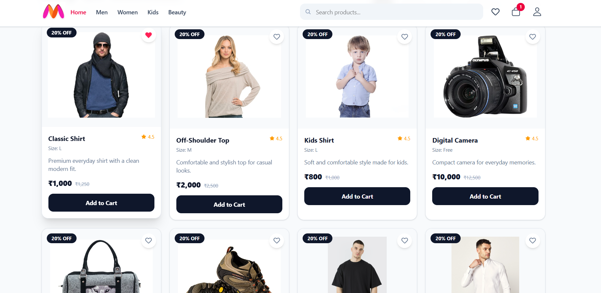
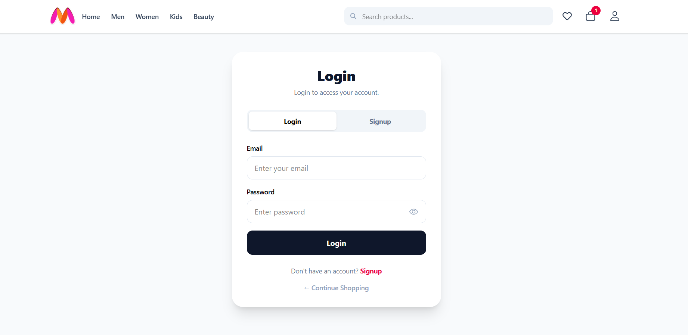
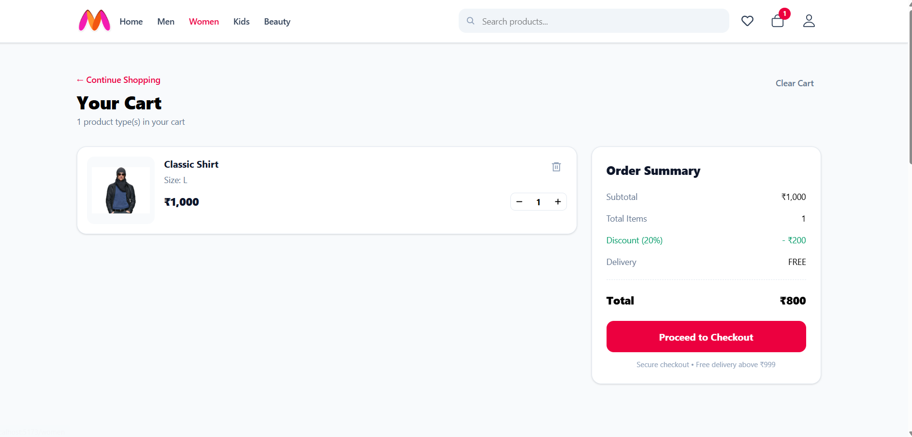

# 🛍️ React E-Commerce Website

A modern and responsive e-commerce website built using **React.js, Vite, Tailwind CSS, React Router, Context API, and useReducer**.

This project provides a complete shopping experience with product browsing, category navigation, authentication, wishlist, cart management, order placement, and user profile features.

## 🚀 Live Demo

Add your deployed website link here:

**Live Website:** `YOUR_NETLIFY_URL`

## 📂 GitHub Repository

**GitHub:** `https://github.com/dimpaldhake/react-ecommerce.git`

---

## ✨ Features

### 🏠 Home Page

* Responsive home page
* Product listing
* Product search
* Image slider
* Navigation between categories

### 👕 Product Categories

* Men
* Women
* Kids
* Beauty
* Product cards with image, price, size, description and rating

### 🛒 Shopping Cart

* Add products to cart
* Increase product quantity
* Decrease product quantity
* Remove products from cart
* Clear cart after successful order
* Cart item count in header
* Cart data stored in Local Storage

### ❤️ Wishlist

* Add products to wishlist
* Remove products from wishlist
* Wishlist data stored in Local Storage
* Wishlist icon with active state

### 🔐 Authentication

* User signup
* User login
* Logout
* Protected routes
* User session stored using Session Storage
* User profile management

### 📦 Orders

* Place an order after login
* Order confirmation
* Order total
* Order date
* Order status
* Orders stored in Local Storage

### 👤 Profile

* View user profile
* Update profile information
* Logout functionality

### 💰 Order Summary

* Subtotal calculation
* Total item calculation
* 20% discount
* Delivery fee calculation
* Free delivery above ₹999
* Final total calculation

### 📱 Responsive Design

* Mobile-friendly navigation
* Responsive product cards
* Responsive cart layout
* Mobile menu
* Responsive header and footer

---

## 🛠️ Technologies Used

| Technology      | Purpose                          |
| --------------- | -------------------------------- |
| React.js        | Frontend development             |
| Vite            | Development and build tool       |
| JavaScript      | Application logic                |
| Tailwind CSS    | Styling and responsive UI        |
| React Router    | Page navigation                  |
| Context API     | Global state management          |
| useReducer      | Cart state management            |
| React Icons     | Icons                            |
| React Hot Toast | Notifications                    |
| Local Storage   | Cart, wishlist, users and orders |
| Session Storage | Login session                    |

---

## 📁 Project Structure

```text
src/
│
├── components/
│   ├── CartItem.jsx
│   ├── CartSummary.jsx
│   ├── Header.jsx
│   ├── ProductCard.jsx
│   └── ProtectedRoute.jsx
│
├── context/
│   ├── AuthContext.jsx
│   ├── CartContext.jsx
│   └── CartReducer.jsx
│
├── data/
│   ├── AppRoutes.jsx
│   ├── Product.jsx
│   └── ProductData.jsx
│
└── pages/
    ├── Beauty.jsx
    ├── Cart.jsx
    ├── Footer.jsx
    ├── Home.jsx
    ├── Kids.jsx
    ├── Login.jsx
    ├── Men.jsx
    ├── Orders.jsx
    ├── Profile.jsx
    ├── Slider.jsx
    ├── Wishlist.jsx
    └── Women.jsx
```

Cart information is saved in **Local Storage**, allowing the cart to remain available when the user refreshes the page.

---

## 🔐 Authentication

The application includes a basic frontend authentication system.

### Signup

New users can create an account with:

* Name
* Email
* Password
* Phone
* Address

User information is stored in:

```text
fashion_users
```

### Login

Registered users can log in using their email and password.

The currently logged-in user is stored in:

```text
loggedInUser
```

using Session Storage.

---

## ❤️ Wishlist

Wishlist products are stored in Local Storage using:

```text
wishlist
```

Users can add or remove products by clicking the heart icon on a product card.

---

## 📦 Order Management

When a logged-in user completes checkout:

1. The order is created.
2. Order ID is generated.
3. Order date is recorded.
4. Order status is set to `Confirmed`.
5. Order total is calculated.
6. Cart is cleared.
7. User is redirected to the Orders page.

Orders are stored in:

```text
fashion_orders
```

---

## 💵 Pricing Calculation

The application calculates the order total using:

```text
Subtotal = Product Price × Quantity

Discount = 20% of Subtotal

Delivery = ₹15

Free Delivery = Subtotal ≥ ₹999

Total = Subtotal - Discount + Delivery
```

---

## 🔔 User Notifications

**React Hot Toast** is used to display notifications such as:

* Product added to cart
* Product added to wishlist
* Product removed from wishlist
* Login required
* Order successfully placed

---

## ⚙️ Installation

### 1. Clone the repository

```bash
git clone YOUR_GITHUB_REPOSITORY_URL
```

### 2. Open the project

```bash
cd your-project-name
```

### 3. Install dependencies

```bash
npm install
```

### 4. Start the development server

```bash
npm run dev
```

The application will run on the local development server provided by Vite.

---

## 📸 Screenshots


### Home Page


### Product Page



### Login Page



### Cart Page




---

## 📄 Documentation

Detailed project documentation is available in the Word document included with this project:

**E-Commerce Documentation.docx**

The documentation contains information about the project, features, implementation and functionality.

---

## 🔮 Future Improvements

* Backend integration
* MongoDB/MySQL database
* Real payment gateway
* Product details page
* Product filtering and sorting
* Admin dashboard
* Real user authentication
* Password encryption
* Product reviews and ratings
* Order tracking
* Online payment integration

---

## 👩‍💻 Developer

**Dimpal Dhake**

### Technologies

`React.js` • `JavaScript` • `Tailwind CSS` • `React Router` • `Context API` • `useReducer` • `Vite`

---

## ⭐ Project

If you find this project useful, consider giving it a ⭐ on GitHub.
 